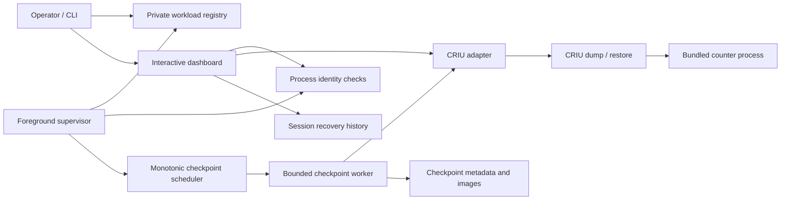

# ChronoOS: A Supervised Linux Process Checkpointing and Recovery Demonstrator

ChronoOS is an Operating Systems demonstrator for supervised checkpointing and
manual recovery of the bundled C counter workload on Linux. It uses CRIU for
process image creation and restoration, while ChronoOS handles managed process
identity, checkpoint metadata, scheduling, operator confirmation, and
verification. ChronoOS is not an independent checkpoint engine and does not
implement bpfCP.

## Problem and motivation

A process contains state in memory and kernel-managed resources that ordinary
application restart does not preserve. This project demonstrates how an
existing Linux process can be captured and restored with CRIU, and how a
supervising program can verify which process it is managing before acting on
it. The bundled counter makes application-state continuity directly
observable without claiming arbitrary application compatibility.

## Objectives and scope

- Inspect Linux process metadata through `/proc`.
- Launch and identify the bundled counter workload.
- Supervise registered processes and schedule bounded periodic checkpoints.
- Validate checkpoint metadata and artifact layout before publication.
- Demonstrate a genuine CRIU leave-running checkpoint.
- Require explicit confirmation before stopping the original demo process.
- Verify the restored process identity and in-memory counter progression.

Automatic crash recovery and arbitrary-process checkpoint authorization are
out of scope. Generic process registration does not establish CRIU compatibility
or authorize arbitrary processes for checkpointing. External side effects are
not rolled back.

## Architecture

The foreground supervisor provides process monitoring and periodic checkpoint
scheduling. The separate dashboard demonstrates a user-controlled
checkpoint/termination/restore workflow; it does not turn supervisor failure
detection into automatic recovery.



## Technology stack

- C11 and POSIX/Linux process APIs.
- Linux `/proc`, pidfds where available, signals, Unix-domain sockets, and
  filesystem locking.
- CRIU for genuine process dump and restore.
- Make and shell regression/integration tests.

There is no application version assigned in the current source tree. Runtime
CRIU version is shown separately by the demo.

## Quick start

```sh
make
make test
./build/chrono dashboard
```

The interactive dashboard guides the presenter through a numbered, single-session
workflow: launch the bundled counter, inspect and monitor it, create and select
a checkpoint, explicitly stop the original, restore, verify, and view a recovery
report. Custom executables are not supported. See the [professor demonstration guide](docs/PROFESSOR_DEMO_GUIDE.md)
for preflight, exact commands, a speaking script, and viva questions. The
[IEEE-style project report draft](docs/PROJECT_REPORT.md) records current scope
and verified results without presenting tests as performance benchmarks.

## Key OS Concepts

ChronoOS focuses on the following Operating Systems concepts:

- Process Management
- Process Control Block (PCB)
- Process State
- Process Identification (PID)
- Virtual Memory
- Memory Management
- System Calls
- Signals
- File Descriptors
- Inter-Process Communication
- Process Creation and Termination
- Process Recovery
- Checkpointing and Rollback

## Phase 1: CLI and process inspection

Phase 1 provides a small C CLI that reads metadata for an explicitly selected
process through `/proc`, plus a counter workload for later checkpoint/restore
experiments. It does not stop processes or invoke CRIU.

Build with `make`. The binaries are written under `build/`:

Run the Phase 1 regression suite with `make test`. It builds the programs and
checks process inspection, PID argument validation, UID parsing, and counter
shutdown on SIGINT and SIGTERM.

```sh
./build/chrono inspect PID
./build/counter_workload [interval-seconds]
```

The inspection command rejects PID 1, itself, and processes owned by another
user (unless run with effective UID 0). Run the counter workload as your own
user; it prints an incrementing counter and exits cleanly on SIGINT or SIGTERM.

Restoring a process does not reverse external effects such as completed file
writes, database changes, or network requests.

## Phase 2: controlled counter lifecycle

`chrono launch counter [interval]` launches only the bundled
`counter_workload` file beside the actual ChronoOS executable (interval
defaults to one second and must be 1..60). ChronoOS resolves its own executable
through Linux `/proc/self/exe`, so PATH invocation and symlink invocation use
the real executable's directory, independent of the current working directory.
The sibling workload must be a regular executable owned by the current UID and
must not be a symlink. ChronoOS opens and executes the validated file inode;
launch fails if that file cannot be identified or validated.
It prints a PID and Linux `/proc` start-time tick count. Keep both values as the
process identity:

```sh
./build/chrono launch counter 1
./build/chrono status PID STARTTIME
./build/chrono stop PID STARTTIME
```

Status and stop verify the start time, workload executable device/inode, owner
UID, a random per-launch token in the process command line, and the
`counter_workload` command line. Stop opens a Linux pidfd before validation and
sends SIGTERM only through that descriptor. If pidfd support is unavailable,
status and stop refuse to act. ChronoOS records launched identities in a
per-user mode-0700 directory under `/tmp`, using mode-0600 records and a lock
file. Stale records are removed only when `/proc` proves the recorded process
is gone, the PID has a different start time, or its live command line lacks the
recorded per-launch token; malformed or unreadable records fail closed.
Callers must retain both printed values, and records may
disappear at reboot. The token and registry protect against accidental PID
reuse and other users, but processes running as the same UID can inspect the
token in `/proc` and modify their own registry; this is not a boundary against
hostile same-UID processes. The CLI does not accept arbitrary commands or
paths.

The launcher forks and execs the counter in a new session, closes its inherited
terminal streams, and exits after receiving the exec handshake. The counter is
therefore not terminated when the CLI returns. Once the CLI exits, the counter
is reparented to the system's init process, or to the nearest configured child
subreaper. That adopter is responsible for reaping it when it exits; ChronoOS
cannot collect its exit status after detaching. While the launching CLI is
alive, it performs a nonblocking wait if the child already exited. There is no
supervisor or persistent wait-status service in this phase. The start-time
identity, separate session, and retained process state provide the basis for
the Phase 3B CRIU adapter; Phase 2 alone does not dump or restore processes.
Before exec, unrelated inherited file descriptors are marked close-on-exec so
the managed workload does not retain ambient parent descriptors.

Run `make test` for process inspection and controlled lifecycle coverage.

## ChronoOS 2.0 Phase 1: supervised process registration

The Phase 1 registration layer gives each explicitly launched workload a
persistent ChronoOS ID independent of its Linux PID. It supports multiple
commands and arguments:

```sh
./build/chrono protect -- ./build/counter_workload 1
./build/chrono protect -- /usr/bin/sleep 60
./build/chrono list
./build/chrono status cp-000001
./build/chrono stop cp-000001
```

`protect` starts the requested executable in a new session, verifies its
executable identity and `/proc` start time, then atomically records the
registration. It prints a stable `cp-NNNNNN` ID and the current PID. Records
are kept under `$XDG_STATE_HOME/chronoos`, or
`$HOME/.local/state/chronoos` when `XDG_STATE_HOME` is unset. The registry
directory is private (mode 0700), and record and lock files are mode 0600.
Metadata uses the versioned `CHRONO-PROCESS-1` text format; path and command
fields are hex-encoded in records. The environment is not stored. Command-line
arguments can contain secrets, so do not pass credentials as arguments to a
registered process. Registry replacement uses a temporary file, file sync,
and atomic rename; malformed, unsupported, or unsafe records fail closed.

`status` and `list` refresh liveness from `/proc` when called. `stop` reloads
the record, checks UID, PID, start time, executable device/inode and command,
then signals through a pidfd-backed verified-stop operation and waits for the
process to exit for at most five seconds. A PID match alone never authorizes a
signal. A process that has already exited is not signaled. Since this phase has no daemon, it cannot
collect exit status after the `protect` CLI exits; an unintentional disappearance
is recorded as `FAILED` with exit status unavailable, while a requested stop is
recorded as `EXITED`. When ChronoOS was still the parent and collected the wait
status, a zero exit is `EXITED` and a nonzero exit or signal is `FAILED`.
`FAILED` in the detached case means the process ended without an observed
intentional stop; it does not prove the process crashed. Registration tracks
the launched process itself, not a complete descendant tree; stopping the
registered leader does not promise to stop children it created.
The verified-stop helper requests SIGTERM through a pidfd only; success means
the signal request was accepted, not that termination was confirmed. If a stop
times out or /proc inspection is temporarily unavailable while the process
entry remains, ChronoOS retains `STOPPING` and reports that termination was
not confirmed. Registration failure cleanup uses
the same verified SIGTERM mechanism with a bounded wait and does not attempt
an unverified escalation; if cleanup cannot confirm exit, its error reports
the child PID/start time and that the process may remain.

This phase does not schedule checkpoints or restart a process, and it does not
change the existing CRIU checkpoint and restore interfaces. Registration IDs
remain stable across future PID changes, but restore is not yet integrated
with this registry. The registry is per-user state, not a security boundary
against another process running as the same UID. Use `./build/chrono --help`
for the complete command list and `make test` for registry and CLI regression
coverage.

## Phase 3A: checkpoint metadata

Phase 3A adds private per-user metadata records with validated IDs, original
PID and `/proc` start-time identity, creation time, workload/executable fields,
backend name, and `PREPARING`, `COMPLETE`, or `FAILED` lifecycle states. Only
`COMPLETE` records appear in `chrono checkpoints`. Metadata files are written
with mode 0600 in a mode-0700 directory under `/tmp`; updates use a temporary
file and atomic rename. The directory is checked for ownership and permissions
and files are opened relative to its directory descriptor without following
symlinks. Listing is read-only; if the directory does not exist, it succeeds
with an empty result. A reported write error after publication can leave the
new metadata visible while directory durability remains uncertain.

The CHRONO1 metadata format is retained in Phase 3B. This metadata layer alone
does not capture process state. The artifact directory is derived from the
validated checkpoint ID as `CHECKPOINT_DIRECTORY/ID`.

Transitions out of `PREPARING` are serialized with a directory-local lock, so
among callers using the same directory at most one can successfully make the
transition; the lock relies on local filesystem `flock` semantics and does not
coordinate independent copies of the metadata directory. `COMPLETE` describes
the metadata transition; the CLI reports artifact validity separately and
validates CRIU inventory and file ownership/modes before restore.

## Phase 3B: optional CRIU backend

The CRIU adapter executes the CRIU binary directly with an argument vector; it
does not use a shell. Set `CHRONO_CRIU_PATH` when CRIU is not at the documented
fallback path `/usr/sbin/criu`. By default, before each operation ChronoOS runs
`criu check` and fails closed when the required kernel feature check does not
pass. When `CHRONO_CRIU_UNPRIVILEGED` is unset, ChronoOS selects CRIU's
`--unprivileged` mode automatically for non-root runs; root runs use CRIU's
default mode. Setting it to `1` explicitly selects `--unprivileged`, while `0`
forces CRIU's default invocation. Any other value is rejected. There is no
fallback after a selected mode fails. CRIU's
`--unprivileged` option accepts its limitations when running as non-root; it
does not grant capabilities or bypass host restrictions. CRIU 4.3 documents
that non-root operation requires at least `CAP_SYS_ADMIN` or
`CAP_CHECKPOINT_RESTORE`, subject to the operation and system policy. A
successful check establishes only that the check passed in that execution
context; it does not guarantee that a particular process can be dumped or
restored. ChronoOS does not install CRIU or change system
capabilities. CRIU needs access to the target's `/proc` information and uses
ptrace while collecting process state. Kernel support such as
`CONFIG_CHECKPOINT_RESTORE` and, depending on the process and operation,
capabilities such as `CAP_CHECKPOINT_RESTORE` may be required. The exact access
requirements depend on the target resources and security policy; a passing
basic CRIU check does not guarantee every workload can be dumped or restored.
`CHRONO_CRIU_PATH` is executed as the selected backend and is not cryptographically
authenticated by ChronoOS. Point it only to a trusted, genuine CRIU binary. The
restore adapter rejects nonexistent or mismatched PIDs, but process identity
checks alone cannot prove that a deliberately deceptive configured executable
performed CRIU restoration; fake-backend tests are orchestration tests only.
See the [CRIU kernel check guide](https://criu.org/CLI/cmd/check), [kernel
requirements](https://criu.org/Linux_kernel), and [checkpoint/restore
design](https://criu.org/Checkpoint/Restore).

For managed-counter dumps, ChronoOS now performs a workload-scoped Yama
authorization handshake. The workload listens on a per-launch abstract Unix
`SOCK_SEQPACKET` endpoint derived from the private registry identity. Before
execing CRIU, the adapter child connects, and the workload checks Unix peer
credentials, the target PID/start time, and the launcher's executable inode.
The workload then calls `PR_SET_PTRACER` for that exact pre-exec child PID.
ChronoOS releases the child only after receiving the workload's successful
acknowledgement and socket closure. The workload closes its endpoint before
the dump and clears the authorization after that tracer PID exits or its start
time changes. This can satisfy Yama's mode-1 tracer relationship for this
managed workload; it does not grant `CAP_SYS_PTRACE`, bypass other LSM or
kernel checks, or guarantee CRIU can interrupt, dump, or restore the process.
Linux also permits descendants of the designated tracer to ptrace the target
while this authorization is active. The mechanism authorizes only one selected
tracer PID, never `PR_SET_PTRACER_ANY`, and is not a security boundary against
malicious processes running as the same user. It is used only for managed
counter dumps; restore and preflight do not request target authorization.

`chrono checkpoint PID STARTTIME ID` requires the managed PID/start-time pair
to pass the Phase 2 registry, executable, token, and process checks. It creates
an exclusive private artifact directory, invokes CRIU dump for the process
tree, validates `inventory.img` and artifact ownership/modes, and only then
transitions metadata to `COMPLETE`. Failed or partial directories are retained
for inspection and never treated as usable. Existing IDs and artifact
directories are not overwritten.

The CLI retains the pidfd and repeats the registry, PID start-time, executable,
owner, and token checks immediately before dispatch. CRIU receives a numeric
PID rather than the pidfd and runs its capability check before dumping, so a
small race remains between validation and CRIU opening the target. The current
CRIU interface cannot make that operation atomic with the pinned pidfd; the
identity checks reduce the window but do not eliminate it.

`chrono checkpoints` prints metadata state separately from `ARTIFACT=valid` or
`ARTIFACT=missing-or-invalid`. The supported workload is the bundled detached
`counter_workload` process tree. Artifact validation requires a private
owner-controlled directory and a flat set of nonempty regular `.img` files
including `inventory.img` plus at least one payload image. It also accepts
CRIU's nonempty regular `stats-dump` and `stats-restore` sidecars; links,
special files, unsafe ownership or permissions, and unexpected entries are
rejected. These checks establish filesystem layout and basic presence only.
ChronoOS does not decode
CRIU's version-dependent inventory or prove cross-image consistency,
completeness, or restorability. The flat image-directory layout and the
`stats-dump`/`stats-restore` sidecars were observed in real CRIU 4.3 runs; fake
adapter tests do not establish general format compatibility. A failed dump can leave
structurally plausible partial
images, so it remains `FAILED` and is not eligible for restore; those files are
retained as diagnostic evidence. Completed metadata alone does not establish that CRIU files
exist or can be restored. Restore requires a completed record and structurally
secure artifacts. A private one-time marker prevents repeated restore
attempts. If CRIU reports success but the PID file is absent, invalid, or does
not identify a live same-user process with the checkpoint executable,
ChronoOS reports that restoration may have occurred and does not retry. The
restored PID is reported only after process identity verification. CRIU may reuse the original
numeric PID after the original process is gone; ChronoOS uses start time and
executable identity to distinguish process instances. Restore does not
replace the original Phase 2 registry entry. A
successful CRIU dump normally terminates the original process.

The adapter waits synchronously for CRIU with a 120-second monotonic deadline.
On expiry it sends SIGTERM, waits up to five seconds, and sends SIGKILL if the
CRIU child has not exited; it then reaps the child and reports the timeout.
The opt-in integration harness also places GNU `timeout` bounds around
preflight and CLI calls. A timeout does not prove a dump left no partial
artifacts or that a restore had no effect. Preserve the artifacts and
diagnostics, and do not retry an ambiguous restore. The adapter can terminate
and reap its direct CRIU child, but it cannot claim that a timed-out dump or
restore had no side effects on the target or system.

The managed counter is detached into its own session, while CRIU operates on
process trees. Restore may depend on namespace, kernel feature, capability,
security policy, file, socket, mount, and network support for the captured
tree. A successful dump does not prove that restore will work. Use an authorized
disposable Linux environment with suitable Linux capabilities, CRIU
permissions, and kernel support
for end-to-end experiments. Build with `make` and run `make test`, then set
`CHRONO_CRIU_PATH` and use a managed counter:

```sh
export CHRONO_CRIU_PATH="$HOME/criu-source/criu/criu"
./build/chrono launch counter 1
./build/chrono checkpoint PID STARTTIME trial-1
./build/chrono checkpoints
./build/chrono restore trial-1
```

Replace `PID` and `STARTTIME` with the values printed by `launch`. Observe
CRIU's diagnostics and both PIDs. Restore is attempted once per checkpoint ID.

The fake executable in `make test` covers argument dispatch, exit and signal
failures, availability checks, artifacts, PID reporting, stale managed
identity rejection, malformed control requests, and the control-channel
handshake against a real managed counter. The handshake test exercises the
workload's real `prctl()` call but uses fake CRIU for the dump itself. Fake
tests do not establish real checkpoint or restore behavior.

On the institute host checked on 2026-11-02, CRIU 4.3 was available at
`/usr/sbin/criu`. Plain `criu check` exited 1 because a non-root invocation
requires `--unprivileged`. `criu check --unprivileged` exited 0 and printed
`Looks good.` An earlier dump, before workload-scoped tracer authorization,
failed with `Unable to interrupt task ... (Operation not permitted)`. That
historical log is no longer available, so Yama was a supported hypothesis,
not a conclusively isolated cause. ChronoOS then added the exact-PID
`PR_SET_PTRACER` handshake described above, without changing host capabilities
or security settings.

The 2026-11-21 non-root shell reproduced the mode mismatch directly:
`/usr/sbin/criu check --unprivileged` exited 0, while `criu check --all` exited
1 with CRIU's message that a non-root caller must use `--unprivileged`.
ChronoOS now chooses that option automatically when the environment variable
is unset and the effective UID is non-root. `CHRONO_CRIU_UNPRIVILEGED=0`
explicitly restores the default invocation. This corrects the observed
preflight invocation mismatch; it does not bypass host policy or guarantee that
a later dump/restore will pass.

After that change, `make test-criu-integration` completed successfully on
CRIU 4.3. The real dump exited successfully and produced the expected image
files plus `stats-dump`; the original managed workload was confirmed stopped;
restore returned PID 8556; and the independently identified restored counter
advanced from 2 to 3. The retained run is
`/tmp/chronoos-criu-integration-CqhJDz` (harness exit 0). A first attempt
after the authorization change exposed the unrecognized `stats-dump` artifact
sidecar and was retained separately; the validator was then corrected and
tested. A real run of `CHRONO_CRIU_UNPRIVILEGED=1 ./build/chrono demo` also
completed all stages after the demo was fixed to reap its own original child
before restore. It verified the pre-dump counter 4, restored counter 5, later
counter 6, executable identity, and cleanup; the retained log is
`/tmp/chronoos-demo-pUJ1wZ/demo.log`.

These results verify the bundled managed counter on this host and CRIU 4.3.
They do not establish support for arbitrary applications or all process
resources. In particular, successful counter restore does not establish
restoration of external side effects, all sockets, devices, or every kernel
resource.

In the inspected WSL2 environment, `/usr/sbin/criu` reports version 3.16.1
and `criu check` exits 1 after `Unable to create a socket: Operation not
permitted` while initializing `kerndat_tcp_repair`. The current process has
zero effective, permitted, and bounding capabilities; `/proc/self/status`
reports seccomp mode 2 with one filter; and `unshare -n true` also fails with
`Operation not permitted`. These observations establish that CRIU's
kernel-feature preflight cannot run in this execution context. They do not
isolate seccomp, WSL, or another container/host policy as the sole cause. Do
not change shared machine security configuration to work around these limits.

For real integration work, use a disposable Linux machine or VM with CRIU
supported kernel features, accessible procfs, and the privileges required by
the selected workload and kernel policy. Keep integration tests separate from
`make test`: use a dedicated managed counter, a fresh checkpoint ID, and an
empty private checkpoint directory; run `criu check` first; checkpoint the
counter; verify it stopped and inspect the checkpoint listing; restore once;
verify the reported restored PID is live and its counter continues from the
captured value; record its `/proc` start time, confirm its command line is the
counter workload, and send SIGTERM only to that verified test PID. Preserve
failed artifacts for diagnosis, and remove only the test's own checkpoint
directory after confirming it contains no needed evidence. Never run this plan
against a production process or shared state.

## Phase 3C: real CRIU readiness and opt-in validation

Phase 3B is the adapter work described above. Phase 3C adds a
separate opt-in target, `make test-criu-integration`; normal `make test` remains
independent of real CRIU privileges. The integration target selects
`CHRONO_CRIU_UNPRIVILEGED=1` and runs `criu check --unprivileged`, matching the
adapter's check, dump, and restore mode. A failed check is reported as **preflight blocked**
(exit 77), and the script does not invoke `criu dump` or `criu restore` in that
case. Missing `timeout` is reported as a skipped test. On a host that passes
preflight, the script uses a dedicated ChronoOS counter, an isolated mode-0700
checkpoint directory, a fresh ID, and bounded waits. The counter writes an
optional test-only observable value when `CHRONO_TEST_STATE_FILE` is set. The
script verifies completed metadata and artifacts, the restored executable and
owner, and that the observable counter advances after restore only after the
original PID/start-time is confirmed stopped and the restored process is
identified. The state file by itself is not treated as proof of restoration.
It terminates the restored process through a pidfd helper only after checking
its executable, UID, PID, and start time against the process it identified.
If pidfd validation fails, cleanup does not fall back to signaling by PID.
Test artifacts are deliberately left
in the printed directory for review; remove only that specific generated
directory after inspection.

`CHRONO_CHECKPOINT_DIR` allows an absolute, private directory to be supplied
for an isolated run. The normal CLI default remains
`/tmp/chronoos-checkpoints-UID`; metadata and artifact code still validate
ownership, permissions, and symlink handling. Run the safe suite and the
opt-in real integration attempt with:

```sh
make
make test
make test-criu-integration
```

In the inspected WSL2 execution context described above, `criu check` fails at
TCP_REPAIR socket setup. On the institute host, unprivileged preflight and a
real managed-counter checkpoint/restore passed. A preflight success alone is
not evidence of dump/restore support. A supported isolated Linux installation
or disposable VM must provide
CRIU-supported kernel features, accessible procfs, and the permissions
required by the selected process; a generic container or another WSL
distribution is not presumed suitable.

The institute run does not establish full CRIU image compatibility or
restorability across arbitrary workload resources and kernel versions.
Additional supported workloads and failure-recovery cases remain unverified.

### Phase 4 validation status

- **IMPLEMENTED:** managed counter lifecycle, checkpoint metadata and artifact
  checks, CRIU adapter, and an opt-in integration harness with preflight and
  bounded CLI calls.
- **TESTED WITH FAKE CRIU:** adapter arguments, artifacts, metadata outcomes,
  PID-file validation, and failure diagnostics through `make test`.
- **TESTED WITH REAL CRIU:** CRIU 4.3 unprivileged preflight, dump, restore,
  restored executable identity, counter continuity, and safe cleanup passed
  for the dedicated counter on the institute host. The earlier
  `Operation not permitted` failure preceded exact-PID workload authorization.
- **ENVIRONMENT-BLOCKED:** the inspected WSL2 context fails `criu check` at
  TCP_REPAIR socket setup with `Operation not permitted`. This does not apply
  to the verified institute-host managed-counter run.
- **NOT YET VERIFIED:** arbitrary-process support, all process resources,
  external side-effect rollback, and compatibility with other CRIU/kernel
  versions.

## Live Terminal Dashboard

Build and launch the dashboard with the institute host's unprivileged CRIU
mode:

```sh
make
./build/chrono dashboard
```

`./build/chrono dashboard` opens a numbered, progressive menu in one session.
Use options 1, 3, and 4 to launch, inspect, and monitor the bundled counter;
option 5 creates a checkpoint, option 7 browses/selects a session checkpoint,
option 6 requires explicit confirmation before stopping the original, and
option 8 restores the selected checkpoint after a second confirmation. Options
9 and 10 reverify the restored process and display the recovery report; option
11 exits and safely cleans up only processes launched or restored by this
session. Option 2 is intentionally disabled: arbitrary executable checkpointing
is not authorized. `./build/chrono demo-manual` remains the separate
key-driven walkthrough; its `p` process browser is read-only and never signals
or modifies selected processes.
Non-TTY input accepts menu choices and acknowledgements from standard input,
which is also used by regression tests.

The dashboard previews a few processes and the browser pages through every
accessible `/proc` entry; entries that disappear or are inaccessible during
enumeration are skipped and counted. Process rows show PID, PPID, user, state,
`comm`, and executable when readable; command names are display-only, not
authoritative identity. The managed counter is the
existing `counter_workload` C program, which keeps its counter in process memory
and publishes `/proc/<pid>/comm` only as a display hint. The authoritative
counter values come from a peer-credential- and executable-verified query over
the workload's control channel, which reads the actual C variable. No shared
state file is used to claim restored counter continuation. The same query is
available as `./build/chrono counter PID CURRENT_STARTTIME [CHECKPOINT_STARTTIME]`;
the optional checkpoint start time selects the original control endpoint after
restore.

The numbered dashboard routes checkpoint and restore through the existing
managed-counter CRIU adapters. The genuine CRIU 4.3 leave-running, explicit
termination, restore, identity, and counter-continuity workflow was previously
verified with the single-key `demo-manual` implementation. The numbered-menu
orchestration has regression coverage with a clearly labelled fake backend,
but has not been rerun with genuine CRIU after the menu change. Restore is
displayed as verified only after ChronoOS checks PID/start time, UID,
executable identity, and counter progression. CRIU may reuse the original
numeric PID; start time distinguishes the restored instance.

When `CHRONO_CRIU_PATH` is explicitly set, the dashboard labels the backend as
custom and its identity as unverified. Structural artifacts and a matching live
PID cannot authenticate a deliberately deceptive executable; do not treat a
custom or fake backend run as real CRIU evidence.

The screen shows checkpoint ID, creation time, backend, metadata path, image
directory, validation state, and total artifact bytes. Events are labelled
**session history**, not a persistent recovery-history subsystem. The log and
artifacts are retained under the printed mode-0700 run directory; metadata
files and logs are mode 0600. A sample terminal capture can be recorded with:

```sh
script -q -c './build/chrono dashboard' /tmp/chronoos-dashboard.typescript
```

The dashboard manages the verified restored identity for the lifetime of the
demo session. It does not re-register it into the persistent supervisor
registry, automatically recover failures, or claim compatibility with
arbitrary Linux processes. Only the bundled counter has verified end-to-end
support.

For the bounded non-dashboard flow, run `./build/chrono demo`; `demo-interactive`
is its alias. That demo remains separate from the user-controlled dashboard.

`chrono demo` launches only the bundled managed counter, displays `/proc`
identity and live counter samples, attempts a checkpoint through the existing
metadata and CRIU adapter, verifies the original identity stopped, and then
attempts restore and checks the restored executable identity and advancing
counter when each preceding operation succeeds. The monitor samples for four
seconds. Ctrl+C or SIGTERM requests safe cleanup of only the managed process
identities established by that run. Restored cleanup uses a pidfd and matches
UID, start time, executable device/inode, and the workload command line; it
does not fall back to a numeric-PID signal.

The demo creates a mode-0700 run directory under `$TMPDIR` (or `/tmp`) and a
mode-0600 event/CRIU diagnostic log. It directs checkpoint metadata and the
counter's test-only observable state into that run directory and restores any
previous `CHRONO_CHECKPOINT_DIR` and `CHRONO_TEST_STATE_FILE` values when it
exits. Run directories, metadata, partial artifacts, and logs are retained for
review. A checkpoint failure is reported as FAIL, restore remains NOT
ATTEMPTED, and the demo exits nonzero. There is no simulated success mode.

The demo honors `CHRONO_CRIU_PATH` and `CHRONO_CRIU_UNPRIVILEGED`; on this
institute machine select unprivileged mode explicitly:

```sh
CHRONO_CRIU_UNPRIVILEGED=1 ./build/chrono demo
```

CRIU preflight and its version are displayed separately. A passing preflight
does not establish that a process can be dumped or restored. On this host,
CRIU 4.3 unprivileged mode completed a real dump and restore of the dedicated
counter through the demo. The demo verified the restored PID/start-time and
executable, observed the counter continue from 4 to 5 and then 6, and safely
stopped only the verified restored process. The run and diagnostics are
retained at `/tmp/chronoos-demo-pUJ1wZ`. These results apply to this managed
workload and environment only.

The displayed counter is the last persisted workload-state sample read
immediately before the dump request. After a successful restore, the demo
requires the resumed counter to advance beyond that sample and then advance
again while the restored PID/start-time and executable inode remain verified.
This demonstrates observable application continuity; it does not prove
restoration of external side effects or every process resource.

`make test` includes unavailable-CRIU, fake dump failure, EOF, interruption,
and user-confirmation gating tests. The fake dump creates fixture artifacts
and asks ChronoOS's verified managed-process API to stop only its test target;
its fake restore PID is rejected by process identity verification. These are
simulated orchestration checks, not real checkpoint or restore evidence. A
formatter-only summary fixture is also labelled as a simulation.

## Foreground supervisor service

Start the per-user supervisor in a terminal:

```sh
./build/chrono supervisor run
```

It holds an exclusive lock in the private ChronoOS registry, rejects a second
instance, and serves a mode-0600 `SOCK_SEQPACKET` control socket. Requests use
a versioned bounded protocol and the service checks the peer UID. Query or
request graceful shutdown with:

```sh
./build/chrono supervisor status
./build/chrono supervisor shutdown
```

The foreground service refreshes all registered process records once per
second using the existing `/proc` identity and lifecycle logic. It remains
active after the CLI exits and handles SIGINT, SIGTERM, or a socket shutdown.
The service now schedules one periodic checkpoint worker per due workload,
up to four concurrent workers, while continuing registry monitoring. Configure
the interval at registration with `--checkpoint-interval` (1–3600 seconds; the
default is 10 seconds):

```sh
./build/chrono protect --checkpoint-interval 15 -- PROGRAM [ARG ...]
./build/chrono protect --counter --checkpoint-interval 5
./build/chrono status CHRONO_PROCESS_ID
./build/chrono checkpoint-latest CHRONO_PROCESS_ID
./build/chrono checkpoints
```

Scheduling deadlines use `CLOCK_MONOTONIC`; wall-clock creation time remains
for human-readable metadata. Missed ticks are skipped rather than queued. The
supervisor revalidates PID, start time, UID, executable device/inode, and
non-zombie state before starting a job. Checkpoint workers use CRIU's
`--leave-running` mode, so the service does not block while CRIU operates.
Each worker has a 120-second CRIU command deadline and is terminated and
reaped during service shutdown. Only structurally validated output is marked
`COMPLETE`; failed jobs keep `FAILED` metadata and do not replace previous
complete records. CRIU's `--leave-running` mode can leave stale external file
or socket state, so protect only workloads designed and validated for that
mode.

Each workload has an atomically published latest-valid checkpoint reference.
`checkpoint-latest` validates it and can reconstruct a missing/corrupt pointer
by scanning complete artifacts. Retention defaults to three valid checkpoints
per workload and can be set with `CHRONO_CHECKPOINT_RETENTION` from 1 to 100.
Retention and restore operations coordinate with a checkpoint-use lock;
uncertain artifacts are preserved. Metadata records workload/checkpoint IDs,
original PID/start time, creation time, executable, backend, and state. The
artifact validator checks the adapter's flat image layout and inventory marker;
it does not prove image integrity or restorability. Image-size/duration metrics,
detailed persistent failure history, and automatic recovery are not implemented
yet. The scheduler currently tracks at most 32 registered workloads and runs
at most four checkpoint workers at once. Generic workloads that cannot establish
ChronoOS's scoped CRIU authorization will fail checkpointing safely; the bundled
counter is the real-CRIU-supported workload exercised by the integration
harness.

For a presentation-ready checkpoint and failure-detection demo, run:

```sh
sh tests/demo_chronoos.sh
```

The script verifies real CRIU preflight, creates private temporary state, waits
for periodic checkpoints, injects a failure into the exact verified workload,
and shows the resulting FAILED state. It does not claim automatic recovery;
see [demo instructions](docs/demo.md) and [limitations](docs/limitations.md).

Checkpoint scheduling is not crash recovery: the supervisor records detected
failure but does not restore a workload automatically. The supervised and
scheduled checkpoint path is supported and exercised for the bundled
ChronoOS counter. Generic process registration does not grant arbitrary
processes CRIU compatibility or the counter-specific scoped authorization
needed by the current checkpoint adapter. Restoration is a separate,
manually supervised operation; the dashboard requires explicit confirmation
before stopping the original, verifies its termination, then verifies the
restored process identity and in-memory counter progression. Fake-CRIU tests
exercise orchestration and rejection behavior only; they are not genuine
checkpoint or restore evidence. Real CRIU integration is an opt-in test
separate from `make test`.

## Architecture summary

```text
Operator / CLI → private workload registry → foreground supervisor
              → monotonic scheduler → bounded worker → CRIU adapter
Interactive dashboard → verified process identity → explicit stop → CRIU restore
CRIU images → metadata/artifact validation → manually verified counter continuity
