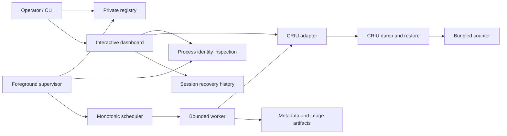
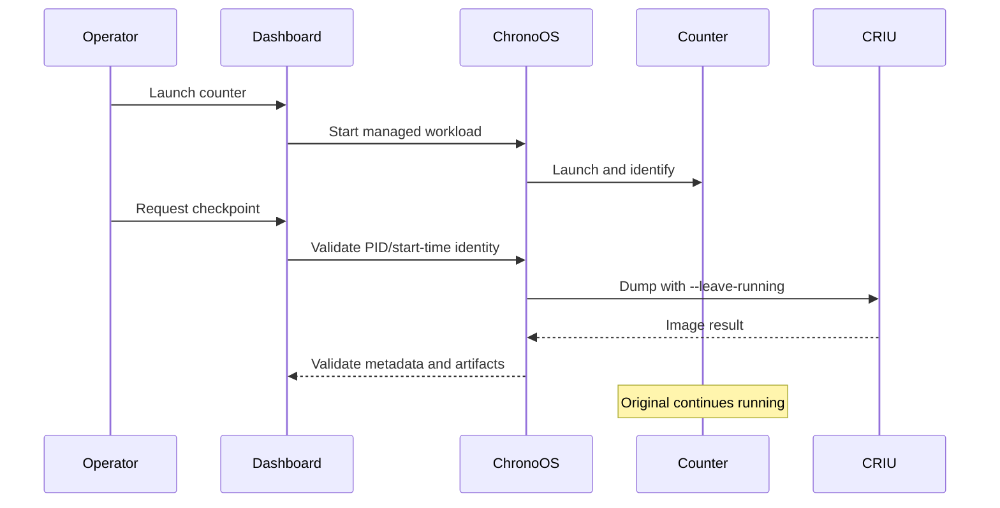
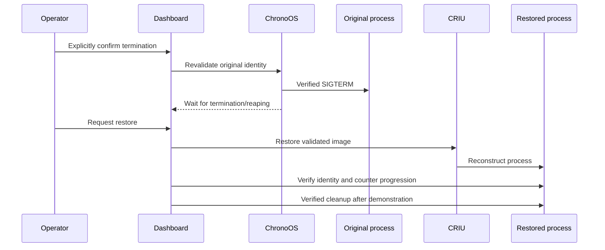

# ChronoOS: A Supervised Linux Process Checkpointing and Recovery Demonstrator

**Authors:** [Student name], [Institution]
**Project category:** Operating Systems
**Report type:** IEEE-style project report draft

## Abstract

ChronoOS is a Linux process supervision and checkpointing demonstrator built
around Checkpoint/Restore In Userspace (CRIU). It combines process inspection,
managed workload identity, a persistent foreground supervisor, periodic
checkpoint scheduling, checkpoint metadata and artifact validation, and an
operator-controlled restore demonstration. The verified application is a
bundled C counter workload. The dashboard demonstrates the sequence of a live
process, a genuine CRIU leave-running checkpoint, explicit confirmation and
verified termination of the original, CRIU restoration, restored-process
identity checking, and in-memory counter continuity. The earlier single-key
workflow was verified on a native Ubuntu host with CRIU 4.3. The current
numbered-menu UI has passed the strict build and regular regression suite,
including an explicitly labelled fake-backend workflow test; its integrated
real-CRIU restore has not been rerun after the UI change. Results apply only to
the bundled counter and tested environment. ChronoOS does not implement
automatic crash recovery or arbitrary-process checkpoint authorization.

**Index Terms—** Linux, process supervision, checkpoint/restore, CRIU, process
identity, recovery demonstration.

## I. Introduction

Applications normally lose volatile execution state after process termination.
Checkpoint/restore systems address this by recording process state and
reconstructing it later. ChronoOS is a course demonstrator exploring how a
supervising user-space tool can manage process identities and coordinate
CRIU-based snapshots without reimplementing the kernel-facing checkpoint
engine.

The project prioritizes an observable and safely bounded experiment over broad
application support. A small C counter provides measurable in-memory state.
The operator can see the original continue after checkpoint creation, confirm
its termination, restore the saved process, and verify that the counter
resumes. The process is supervised using more than its PID so that PID reuse
does not authorize an unintended signal.

## II. Related Work

CRIU provides process and resource dump/restore mechanisms on Linux. ChronoOS
uses the CRIU command-line adapter for this work and adds process registration,
identity verification, checkpoint metadata, scheduling, and presentation
workflow; it does not implement an independent checkpoint engine [1].

bpfCP is a research approach to process checkpointing using eBPF-related
mechanisms [2]. It is conceptually related to the checkpointing problem but is
not used or implemented by ChronoOS.

The project brief also names “Flashback” as a related reference, but does not
identify a paper, authors, venue, or implementation. The name is ambiguous
across unrelated works. To avoid a false attribution, this draft does not make
source-specific technical claims about Flashback. The student should add the
intended course citation before formal submission.

## III. Problem Statement

The project addresses the practical coordination problem around checkpointing
a selected Linux process: identifying the intended process, requesting a
checkpoint, determining whether the original remains alive, verifying
termination before restore, and checking that the restored workload is the
expected process with continued application state.

The scope is deliberately limited to the bundled counter workload. Registration
of a generic command does not prove that the command can be checkpointed or
that ChronoOS has the scoped authorization needed by its current CRIU adapter.
Automatic recovery, arbitrary-process authorization, migration between hosts,
and rollback of external side effects are outside the project.

## IV. Proposed System

ChronoOS contains a CLI, process identity and lifecycle utilities, a private
process registry, a foreground supervisor, a periodic checkpoint scheduler,
checkpoint metadata/artifact management, a CRIU adapter, and an interactive
dashboard. The supervisor detects process state changes and dispatches bounded
checkpoint workers. The dashboard is separate: it explicitly controls the
counter demonstration and does not provide automatic recovery.

### A. Checkpoint workflow

### B. Manual restoration workflow

## V. Implementation Details

### A. Process inspection and identity

ChronoOS reads Linux `/proc` information, including process start time, UID,
state, command and executable identity. PID is not used as a sufficient
identity. The verified stop path uses a pidfd-backed operation where available
and fails closed when safe signaling cannot be established. CRIU ultimately
receives a numeric PID for dump, so a narrow validate-to-attach race remains.
The dashboard also provides a PID-sorted, paginated read-only browser. Refresh
checks the selected process start time before displaying it again; ordinary
processes are never signaled or checkpointed. On terminals shorter than 38
rows, the dashboard switches to a compact overview, and TTY output is clipped
to the available width to keep incremental refreshes aligned.

### B. Managed counter and state verification

The C counter keeps its authoritative value in process memory. ChronoOS queries
that value over a workload control channel that verifies peer credentials and
executable identity. `/proc/<pid>/comm` is a display hint only and is not used
to prove restored state continuity.

### C. Supervisor and scheduling

The foreground supervisor owns the per-user registry lock and a private Unix
`SOCK_SEQPACKET` control socket. It refreshes process identity, schedules
per-workload checkpoints using monotonic deadlines, and dispatches bounded
workers. It detects failures but does not automatically restore a failed
process.

### D. CRIU and checkpoint artifacts

The adapter executes CRIU directly with an argument vector and a 120-second
operation deadline. Its timeout path sends SIGTERM, waits five seconds, sends
SIGKILL to the direct CRIU child if it has not exited, reaps it, and reports
timeout. ChronoOS validates checkpoint metadata and expected artifact layout
before marking a checkpoint complete. Structural checks are not a proof of
image integrity or future restorability.

The dashboard uses `--leave-running` so that the original counter remains
available for explicit user confirmation after the checkpoint. The original
is revalidated and stopped before the manual restore request. After CRIU
returns, ChronoOS independently checks the restored process identity and
observes the in-memory counter advance.

### E. Test separation

The regular suite includes fake-CRIU adapter tests. They exercise argument
construction, metadata transitions, and error handling; the fake executable
cannot establish genuine restoration. The opt-in `make test-criu-integration`
uses installed CRIU and a disposable managed counter. Its artifacts and logs
are kept under a private temporary directory.

## VI. Experimental Setup

Fresh verification was run on 2026-11-21 in an isolated copy of the workspace
to avoid overwriting the repository’s pre-existing `build/` outputs. The host
reported Linux x86_64 and CRIU 4.3. Compilation used the repository’s strict
flags: C11, `-Wall -Wextra -Wpedantic -Werror -O2`.

The real integration script was inspected before execution. It creates a
mode-0700 temporary test directory, starts only its own bundled counter,
stores images below its temporary checkpoint directory, verifies the original
process identity is gone before restore, and cleans up only identities it
established. It also exercises the periodic supervisor with a second
test-created counter.

## VII. Results and Evaluation

All commands below were run in isolated build/test copies:

| Command | Result | Evidence |
|---|---|---|
| `make -B all` | PASS, exit 0 | Current strict full build in `/tmp/chronoos-validation-h775qO` |
| `make test` | PASS, exit 0 | Process, counter, checkpoint, adapter, dashboard, supervisor, CLI, scheduler, and numbered-menu regressions |
| `sh tests/test_counter_workload.sh` | PASS, exit 0 | Dedicated workload/token and signal tests (also run by `make test`) |
| `make test-criu-integration` | PASS, exit 0 | CRIU 4.3 disposable-workload dump/restore and periodic checkpoints; see retained artifacts below |
| `sh tests/test_dashboard_menu.sh` | PASS, exit 0 | Numbered workflow, explicit termination, checkpoint selection, and fake restore rejection; simulation only |
| `./build/chrono dashboard` | Not run with real CRIU after the numbered-menu UI change | Do not treat the fake-backend menu test as genuine CRIU evidence |
| `./build/chrono demo-manual` | Historical genuine workflow evidence below; not rerun in this validation | This remains the separate single-key walkthrough, not an alias |

### A. Real CRIU integration

The exact command `make test-criu-integration` passed in the isolated copy
`/tmp/chronoos-validation-h775qO` with CRIU 4.3. The retained explicit-restore
checkpoint directory was:

`/tmp/chronoos-criu-integration-7bSuYq/checkpoints/integration-128568/`

It contains real CRIU images including `inventory.img`, `core-128585.img`,
`mm-128585.img`, `pages-1.img`, `pstree.img`, `stats-dump`, and
`stats-restore`. The original workload identity was PID 128585 with start time
1409662; the script verified it was absent before restore. CRIU restored PID
128585 with start time 1410129, UID 1000, and executable
`/tmp/chronoos-validation-h775qO/build/counter_workload`. The in-memory counter
advanced from checkpoint-time value 5 through restored values 6 and 7. The
test also produced two genuine periodic supervisor checkpoints while its
separate test workload remained RUNNING, then cleaned up its own restored and
periodic test processes.

### B. Earlier single-key interactive workflow

The following measurements are retained from the earlier single-key dashboard
implementation, before the current numbered-menu interface was added. They
demonstrate the underlying bundled-counter CRIU workflow but are not a real-CRIU
test of the current numbered-menu orchestration.

The live command completed with exit 0 in a 50-row, 120-column PTY. Its
checkpoint image directory was:

`/tmp/chronoos-manual-nBEBBw/checkpoints/manual-70695-1795247244/`

The original identity was PID 70703, start time 745951. The dashboard logged
its verified SIGTERM and reaping after checkpoint validation. CRIU restored
PID 70703 with start time 746029, UID 1000, and executable
`/tmp/chronoos-validation-sRFqzv/build/counter_workload`. The managed
in-memory checkpoint sample was 1; restored samples advanced 2 then 3. The
dashboard showed valid checkpoint metadata and the image directory, reported
verified cleanup, and printed `CHRONOOS DEMONSTRATION COMPLETE`.

The earlier `demo-manual` invocation also exited 0 with the same sequence:
checkpoint directory
`/tmp/chronoos-manual-CPltdI/checkpoints/manual-71003-1795247264/`, original
PID/start time 71009/747944, restored PID/start time 71009/748022, UID 1000,
and in-memory counter progression 1 → 2 → 3. Its final dashboard also showed
valid artifacts after restore and reported completion.

These are reproducible observations from the stated environment, not
performance benchmarks. No timing, speedup, or arbitrary-workload
compatibility claim is made.

## VIII. Limitations

1. Only the bundled counter has verified end-to-end support.
2. Generic registration does not authorize or guarantee arbitrary CRIU dumps.
3. `--leave-running` can leave external resources inconsistent for other
   workloads.
4. Restoring process state cannot roll back external file, database, or
   network side effects.
5. Failure detection and periodic checkpoint scheduling do not implement
   automatic crash recovery.
6. Checkpoint artifact validation checks secure structure and expected files;
   it does not prove image integrity or restorability.
7. The CRIU dump interface accepts a PID rather than a pidfd, leaving a small
   identity-check-to-attach race.
8. Results apply to Ubuntu/Linux and CRIU 4.3 in the verified environment.

## IX. Conclusion

ChronoOS demonstrates a supervised, manually controlled process checkpoint
and recovery path for a bounded Linux workload. Fresh real-CRIU tests show that
the counter can remain live after a leave-running checkpoint, be explicitly
terminated, then be restored with its process identity checked and in-memory
state advancing. The project keeps that result separate from fake-backend
tests and does not overstate it as general-purpose fault tolerance.

## X. Future Work

Possible follow-up work includes a restore-time scoped-authorization
handshake, persistent recovery history, explicit recovery policy, broader
workload-specific compatibility tests, and stronger image-integrity checks.
Automatic recovery should not be added until restored identities, external
resources, and failure handling can be verified end to end.

## References

[1] CRIU, “Checkpoint/Restore,” CRIU Documentation. [Online]. Available:
<https://criu.org/Checkpoint/Restore>. Accessed: Nov. 21, 2026.

[2] J. Deng and S. Kell, “bpfCP: Efficient and Extensible Process
Checkpointing via eBPF,” in *Proc. 3rd Workshop on eBPF and Kernel Extensions
(eBPF)*, 2025, pp. 84–86, doi: 10.1145/3748355.3748373.

[3] “Flashback.” A specific publication or implementation was not identifiable
from the project brief alone. Insert the exact source intended by the course
before submission; no unsupported bibliographic details are supplied here.
