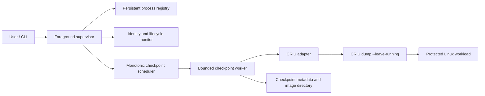
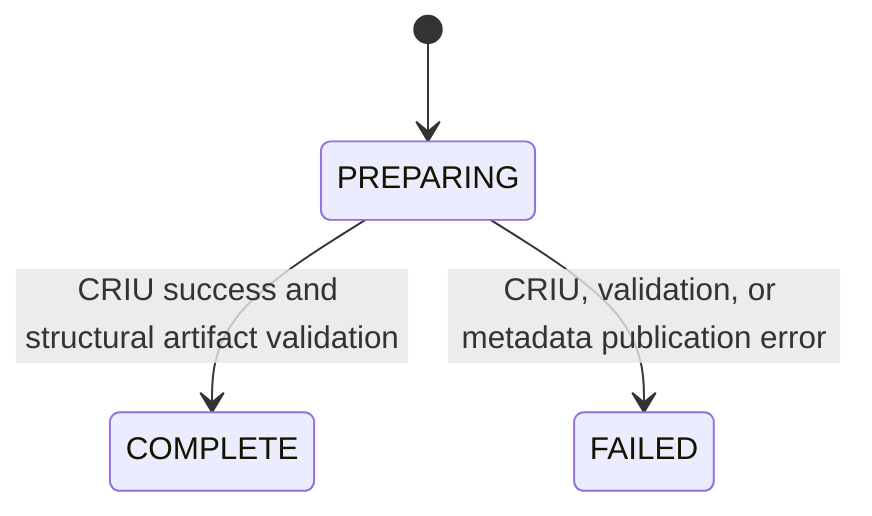

# ChronoOS Architecture

ChronoOS is a per-user Linux process manager. The CLI registers a workload in
the persistent registry. A foreground supervisor owns the registry lock and a
private Unix `SOCK_SEQPACKET` control socket, refreshes process identities, and
dispatches due checkpoint operations to bounded worker processes. CRIU performs
the process dump; ChronoOS validates the output and publishes checkpoint
metadata only after the adapter reports success.

## Supervisor and scheduling

The supervisor has one active instance per registry directory, enforced by an
exclusive file lock. Its private socket accepts versioned status and shutdown
requests and checks client UID credentials. Registry refresh occurs once per
service loop iteration. Scheduler entries preserve a monotonic deadline and
active worker PID across registry reloads. New registrations are discovered
on a subsequent refresh; terminal or intentionally stopped records are not
scheduled.

Intervals are persisted with each process record. The range is 1–3600 seconds
and the default is 10 seconds. On supervisor restart, deadlines are initialized
from restart time; old complete checkpoint records remain available. If a tick
is missed, the scheduler advances to one interval after the current time rather
than launching a catch-up burst. At most four workers execute simultaneously.
Each registered workload has at most one active worker.

Before dispatch, ChronoOS rechecks the process PID, start time, UID, executable
device and inode, and zombie status. A worker runs CRIU in
`--leave-running` mode so dump operations do not block monitoring. CRIU is
bounded to 120 seconds. The supervisor tracks and reaps worker children; on
shutdown it terminates and reaps them. CRIU children receive a parent-death
signal so they cannot remain orphaned if their worker exits.

## Checkpoint lifecycle

Each checkpoint has a unique ID and atomically created metadata in the private
checkpoint directory. Image files are placed in an ID-specific directory. A
checkpoint is listed as complete only after CRIU succeeds, the existing
artifact validator accepts the flat image directory, and the metadata state
transition is atomically persisted. An atomic `latest-WORKLOAD_ID` reference
is advanced only to a matching complete checkpoint with valid artifacts. If
the reference is missing or corrupt, the CLI can reconstruct it by scanning
complete records and validating their image directories. Older checkpoints
remain intact when a new attempt fails.

Retention defaults to three valid checkpoints per workload and is configured
with `CHRONO_CHECKPOINT_RETENTION` (1–100). A shared checkpoint-use lock covers
restore; retention takes the exclusive lock before removing older artifacts.
Deletion traverses only the private, flat CRIU artifact directory and checks
ownership, type, links, and permissions. An artifact that cannot be proven safe
to delete is preserved, so the configured limit is best-effort when storage is
corrupt or permissions are uncertain.

The current metadata includes the checkpoint and workload IDs, original PID
and process start time, wall-clock creation time, executable, backend, and
state. It does not yet persist checkpoint duration, image size, CRIU exit code,
failure detail, or recovery history.
Structural validation checks file ownership, permissions, expected CRIU image
files, and inventory presence; it does not establish image integrity or
restorability.

## Process and authorization model

Process identity uses PID plus `/proc` start time, owner, and executable
identity. PID alone is never considered sufficient. Uncertain `/proc`
inspection errors do not establish process disappearance. The managed counter
uses a scoped control channel to authorize the ChronoOS CRIU process. The
authorization is identity-checked and does not use `PR_SET_PTRACER_ANY`.

The scheduler uses `--leave-running`; CRIU documents limitations for external
resources and applications that mutate files or socket state while running.
Only explicitly registered workloads that meet the current CRIU and
authorization constraints are in scope. Automatic crash recovery is not yet
implemented.
